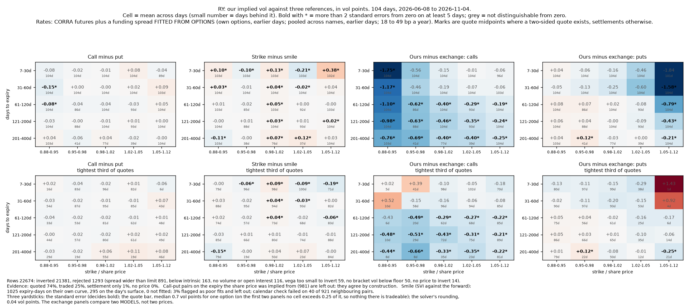
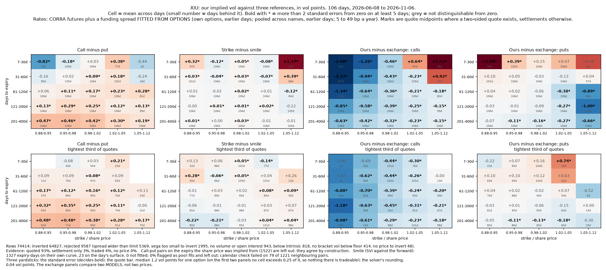
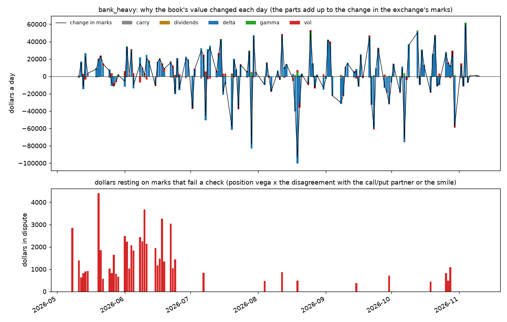
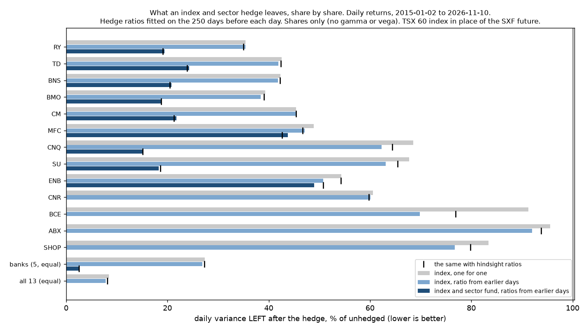
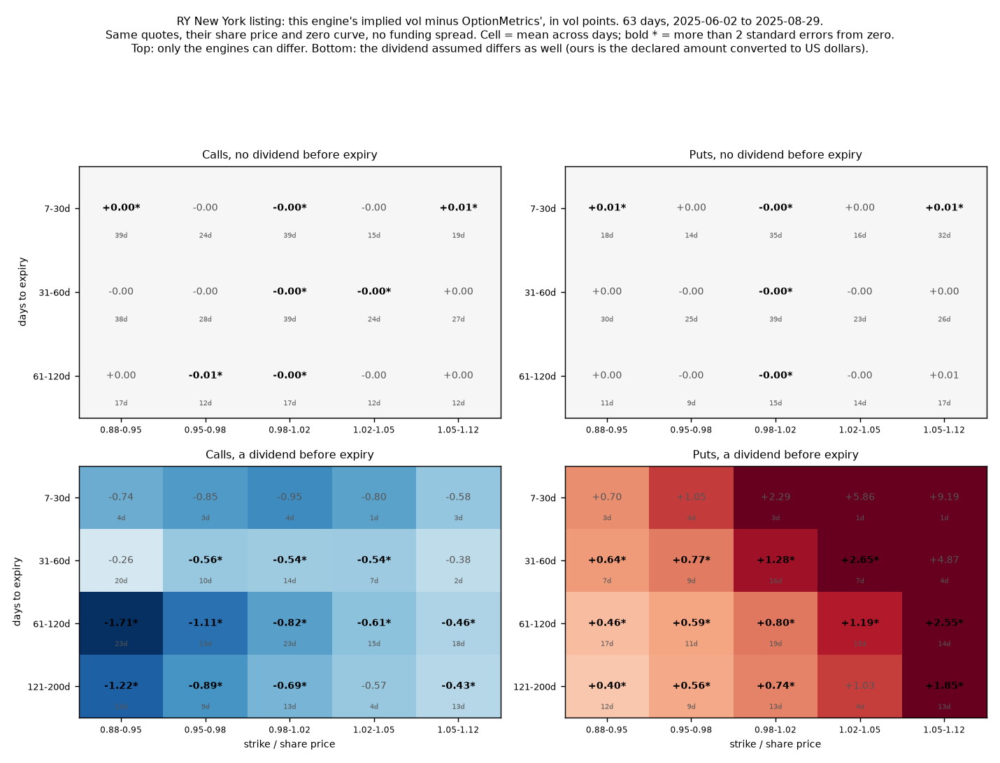

# Marked to the Tape

A risk system for a small book of Canadian listed options. It prices positions with its own engine for American options with discrete dividends. It compares the implied volatilities with Montreal Exchange settlements and with an independent source. Then it replays real historical days and shows what risk is left after hedging with SXF, ZEB and XIU.

**Status:** in progress. Done and tested: the pricing, inversion and Greeks core (`src/voleng.py`), the trading calendar (`src/tradingcal.py`), the Montreal Exchange loader (`src/loaders/mx.py`) and chain inversion (`src/surface.py`). The front chart exists for fifteen names (`scripts/front_chart.py`), RY over 104 days, against three of its four references. Two sample books are marked, explained day by day and have their marks tested (`scripts/book_report.py`); they are not yet hedged. Getting there traced a small, persistent call-put gap to funding cost and to the timing of dividends, as described below.

## What it has found so far

On RY options, May to November 2026. The full account, with what was rejected and
what is still not trusted, is in [docs/findings.md](docs/findings.md).

- **The bid-ask spread is the wrong yardstick for model error.** Quotes are wide, but
  midpoints agree with each other far more closely than the spread suggests. Judged
  against day-to-day scatter, differences ten times smaller than the spread are real.
- **Option forwards sit above the overnight rate.** Call and put prices imply a
  carry adjustment of about 18 basis points a year over a curve built from CORRA
  futures. It is called a funding spread below, but it is whatever makes calls and
  puts agree given this project's share price, dividends and pricing conventions;
  borrow cost cannot be told apart from it. Fitted on earlier days only, it removes
  most of the call-put gap on later days.
- **The time of day a dividend comes off matters.** Placing the share-price drop by
  trading sessions, at the open of the ex-dividend date, removed a 0.6 vol point gap
  on expiries just after an ex-date.
- **Calls, puts and neighbouring strikes then agree** to within about 0.1 vol points,
  and the exchange's own published vols differ from the model's in the direction
  early exercise predicts.

- **The engine matches a second model.** Against OptionMetrics on seven New York
  listings it agrees to 0.006 to 0.011 vol points wherever no dividend is involved.

- **An index and sector hedge removes 76 to 85% of a bank's or oil producer's daily
  variance,** out of sample over twelve years, before trading costs and with the
  index standing in for the future. What is left is not pure noise: a test over ten
  lags finds structure in six of thirteen names, and the worst days are hedged less
  well than the variance.

- **Marks are tested before their P&L is believed.** On two sample books, the
  dollars resting on marks that fail a check exceed half of the day's P&L (share
  move taken out) on a fifth to a third of days.

Not built yet: the hedge stages on the option book (index and sector delta hedge,
then a vega hedge with listed options). The front chart exists for fifteen names on six months each. The plan is in [docs/work-list.md](docs/work-list.md).

## Front chart: model against market, RY



Inverting a price gives one implied vol. To say it is wrong you need a second number,
so each vol is compared with three references and pooled over 104 days (8 June to
4 November 2026), by days to expiry and by strike relative to the share price. The
top row uses every quote; the bottom row only the tightest third.

- **Call minus put.** The call and the put at one strike should agree. A gap means a
  carry input (share price, rate, dividend) is off.
- **Strike minus smile.** Each strike against a curve fitted through the *other*
  strikes of its expiry. A gap means that quote is out of line with its neighbours.
- **Ours minus the exchange's.** Against the vol the exchange publishes in the same
  file, calls and puts apart.

A cell is in bold only when its mean is more than two standard errors from zero on
at least five days. Everything else is not distinguishable from zero. The standard
error allows each day to resemble the three or four before it (Newey-West), because
a slow-moving quote or a slightly wrong dividend pushes neighbouring days the same
way. That widens it by about 1.1 times on the first two panels and 1.65 times on the
exchange panels, compared with treating days as independent.

What it shows:

1. **Calls and puts agree.** No cell is further than 0.15 vol points from zero, and
   23 of 25 cells are within two standard errors of it. The two that are not are
   low strikes at one to four months, at -0.15 and -0.08.
2. **Quotes sit on their smile.** Beyond 30 days no cell is further than 0.12 vol
   points, and between 30 and 200 days none is beyond 0.05. Under 30 days the misses
   are 0.1 to 0.4 and alternate in sign from one strike band to the next, which is
   the curve's shape and not the market: none exceeds 0.25 of a quote bar. The smile
   is SVI, the five-number form desks use, fitted in strike over forward. Each fit
   is screened for butterfly arbitrage on a grid of strikes; that is a screen over
   the strikes tested, not a proof for the whole surface, and these are American
   options. An expiry with fewer than seven strikes is judged against one surface
   fitted across the whole day (SSVI) instead. Of 1,320 expiry-days, 1,025 were
   fitted by their own curve, 295 by the surface and none was left out.
   Neighbouring expiries' curves were also checked for calendar arbitrage (the
   later one sitting below the earlier): 40 of 921 pairs fail, 4.3%.
   Earlier versions used a quadratic, then a cubic; both are in the rejected list.
3. **The exchange's vols differ from ours in the way predicted.** The expected signs
   were written into `scripts/front_chart.py` before the chart was drawn. In-the-money
   puts are up to 1.8 vol points lower on our side, which is what happens when
   early-exercise value is read as extra vol by a European formula. Calls are 0.2 to
   1.1 lower beyond 60 days. One cell of fifty has the opposite sign and is flagged
   (puts just below the money beyond 200 days, +0.12); with fifty cells tested at
   two standard errors, one or two flags are expected by chance. These two panels
   compare two models, not two prices.
4. **Nothing is tradeable.** On the first two panels no cell exceeds 0.25 of a quote
   bar (half the bid-ask spread in vol points, median 0.7 for one option).

Counts behind it: 22,674 rows, 5.7% rejected (mostly quotes wider than the limit).
Of the rows used, 74% rest on a two-sided quote, 25% on a trade and 1% on a
settlement alone. 3% of expiry-days had a smile the curve fitted poorly and were
left out of that panel.

How far a wrong input moves the call-put gap, at the money, in vol points:

| Days to expiry | Share price 10 bp low | Rate 25 bp low | Dividend 5% high |
|---|---|---|---|
| 30 | 0.92 | 0.19 | 0.32 |
| 90 | 0.52 | 0.32 | 0.18 |
| 180 | 0.37 | 0.45 | 0.13 |
| 365 | 0.26 | 0.66 | 0.09 |

The other fourteen names are summarised in "Across fifteen names" below. The fourth reference,
OptionMetrics, is a separate check below, because its data ends before the
Montreal files begin.

## Front chart: XIU, six months



The same chart for the index fund, on 106 days (8 June to 6 November 2026; the first
20 of the 126 days on file are used only to start the funding estimate).

**Funding.** RY's spread is not borrowed: a number fitted from one name's options
carries that name's own dividend and borrow effects. With six months on file XIU has
enough expiries resting on a declared distribution to fit a spread from its own
options, by the same earlier-days-only rule as RY (six early days use the pooled
figure): 13 basis points a year, with a
standard error of 4.2. That is thinner evidence than RY's 17.7 (2.0), because a fund
declares each distribution only about a week ahead. The index's own funding, from the
SXF future, is the better source and is the next step.

- **Calls still sit above puts, more so with maturity:** +0.1 to +0.3 vol points at
  two to six months and +0.2 to +0.47 beyond 200 days, after XIU's own spread. Every
  long expiry rests on a projected distribution, so this says either that funding
  costs more than 13 basis points or that next year's distributions are projected
  too high. The two cannot be told apart from XIU's options alone.
- **Quotes sit on their smile:** 1,327 of 1,350 expiry-days fitted by their own
  curve, 23 by the day's surface, none left out. The calendar check fails on 79 of
  1,221 neighbouring pairs, 6.5%.
- **The options found a wrong input.** The next distribution was first projected for
  19 November, last year's date. Only the 20 November expiry then showed a gap, of 34
  basis points of forward price. The fund's published 2026 schedule gives 25
  November. With that date the implied share price sits 1.0 basis points (standard
  deviation 5.2) from the file's last trade over all 126 days.

12.9% of rows were rejected, against 5.7% for RY: the fund's chain has more strikes
too far from the money to carry a vol. 93% of the rows used rest on a two-sided
quote and only 4% on a trade.

## Across fifteen names

Every name with option files, six months each (`scripts/summary_names.py`,
`reports/all_names_summary.txt`; each name also has its own front chart under
`reports/`). Gaps are call minus put in vol points on monthly expiries over 60 days
out. Two things changed on 12 November and every row was re-run under both: each
day is priced with the dividends as they could have been known that day, and a name
uses its own funding spread only where that is well measured (twenty earlier
estimates, standard error at most 5 basis points), otherwise the median across the
names that are. The spread column is what the name's own options imply; "applied"
says which was used.

| Name | Share price vs last trade (bp) | Own spread (bp a year) | Applied | Gap, declared dividends | Gap, projected dividends | Rows rejected |
|---|---|---|---|---|---|---|
| RY | -0.9 | 17.7 (se 2.0) | own, pooled at first | -0.06 (t -2.2) | +0.01 (t 0.3) | 5.6% |
| TD | -0.4 | 31.5 (2.1) | own, pooled at first | +0.01 (t 0.3) | -0.16 (t -5.8) | 5.3% |
| BNS | +2.0 | 34.7 (2.1) | own, pooled at first | -0.03 (t -1.5) | -0.22 (t -10.4) | 7.8% |
| BMO | +1.3 | 28.9 (2.3) | own, pooled at first | -0.04 (t -1.9) | -0.08 (t -3.2) | 5.2% |
| MFC | -3.4 | -41.0 (10.7) | pooled | -0.97 (t -5.4) | +0.29 (t 2.1) | 12.1% |
| CNQ | +0.1 | 36.8 (11.9) | pooled | -0.18 (t -2.9) | -0.30 (t -5.6) | 3.9% |
| SU | +2.0 | 49.0 (3.1) | own | +0.02 (t 0.4) | +0.03 (t 0.8) | 2.0% |
| ENB | +2.2 | 23.1 (2.7) | pooled | -0.04 (t -1.7) | +0.33 (t 7.3) | 9.0% |
| CNR | -0.1 | 30.1 (2.9) | own | -0.11 (t -6.1) | -0.14 (t -10.6) | 7.4% |
| BCE | +3.3 | 45.7 (2.5) | own | +0.01 (t 0.3) | +0.22 (t 2.8) | 14.7% |
| ABX | +1.4 | 51.4 (3.4) | own, pooled at first | -0.08 (t -1.8) | -1.17 (t -21.7) | 1.8% |
| SHOP | +1.6 | 30.3 (3.0) | own, pooled at first | -0.02 (t -0.3) | none (pays no dividend) | 11.8% |
| XIU | +1.0 | 13.1 (4.2) | own, pooled at first | +0.05 (t 0.8) | +0.24 (t 6.9) | 12.5% |
| ZEB | +0.6 | none could be fitted | pooled | none | -0.43 (t -7.2) | 14.0% |
| XEG | +4.6 | 44.6 (16.2) | pooled | +0.24 (t 1.4) | +0.21 (t 2.1) | 14.9% |

What it shows:

- **The share price implied from options matches the tape on every name,** within 5
  basis points on average. That step generalises.
- **Option forwards sit above the overnight rate on thirteen of fourteen names,** by
  a median of 31 basis points a year. RY's 18 is the lowest of the single names,
  not typical. MFC's own figure is negative, which is a sign of another wrong
  input and not of cheap funding (below).
- **Where dividends are declared, calls and puts now agree on eleven of the thirteen
  names that have such expiries:** within two standard errors of zero, or within
  0.06 vol points, on all but MFC and CNR.
- **What the pooled spread did to the five names that disagreed before.** ENB went
  from +0.24 to -0.04 and XEG from +0.81 to +0.24 (1.4 standard errors): both were
  mis-funded and are now explained. CNQ went from -0.35 to -0.18, half explained.
  CNR is unchanged at -0.11: its own spread is well measured, so the rule left it
  alone, and the cause is still open. **MFC got worse, +0.29 to -0.97.** Its own
  options imply a negative spread, so giving it the median of the others pushed
  the wrong way. The options price its November dividend at 0.64 against the 0.485
  declared (11.7 standard errors), which is what a dividend placed after an expiry
  it actually precedes looks like: the ex-date sits on the 20 November expiry.
  That is the lead to follow, and it is not resolved.
- **The pooled spread costs RY a little.** For its first twenty days RY has no
  estimate of its own and takes the pool's 45 to 49 basis points, well above its
  own 18. Its declared-dividend gap is -0.06 (2.2 standard errors) on 104 days,
  where on the 92 days funded by its own spread it was -0.02. The rule was chosen
  after seeing which names failed, so these 104 days are not an untouched test of
  it.
- **Projected dividends are the weak input, as expected.** The gaps there are larger
  and of both signs. Priced point-in-time, the bank raise rule is now too low for
  TD and BNS, and "same as last year" is too high for XIU and too low for ZEB.
  ABX (-1.17) is a projection in the wrong currency: it declares in US dollars and
  its schedule repeats last year's Canadian-dollar amounts.

### Next year's dividends, three ways

For the dividends not yet declared, three sources that share nothing
(`scripts/dividend_three_way.py`): this project's rule, the amount the options imply,
and analysts' consensus from I/B/E/S (as of 20 August 2026). Fiscal-year totals per
share:

| Name | Fiscal year to | Rule | Options | Analysts (number) |
|---|---|---|---|---|
| RY | October 2027 | 7.68 | 7.54 | 7.49 (8) |
| TD | October 2027 | 4.68 | 4.75 | 4.66 (8) |
| BNS | October 2027 | 4.64 | 4.72 | 4.71 (8) |
| BMO | October 2027 | 7.08 | 7.06 | 7.08 (9) |
| CNQ | December 2027 | 2.65 | 2.64 | 2.57 (13) |
| SU | December 2027 | 2.70 | 2.66 | 2.49 (13) |
| CNR | December 2027 | 3.77 | 3.80 | 3.82 (12) |
| BCE | December 2027 | 1.75 | 1.71 | 1.76 (10) |

On the years already declared the schedule matches analysts to within about 1%,
which checks the bookkeeping. On next year's, the rule is within 2.2% of analysts on
average and the options within 2.0%. On RY and BNS the options and the analysts
agree with each other against the rule. Suncor's consensus predates its November
raise, so that row flatters nobody. The model's inputs are unchanged: this is a
comparison, and a dividend taken from the options would make calls and puts agree
by construction.

## One book, marked and explained



A Greeks report takes the day's marks as given. This one tests each mark before its
P&L is believed (`scripts/book_report.py`, `src/replay.py`; numbers in
`reports/bank_heavy_book.txt` and `reports/diversified_book.txt`). Two made-up
books, struck near the money, valued at the exchange's own marks on every day from
8 May to 10 November 2026.

**Every position could be marked.** 1,244 option position-days in the bank-heavy
book and 1,503 in the diversified one, all from a two-sided quote or a trade.

**The day's P&L is explained with nothing left over.** Each option is repriced one
input at a time: a day passes (decay, funding, an expected ex-dividend drop), the
dividend schedule changes, the share moves (delta, then gamma), vol moves. The parts
sum to the change in the marks exactly. Both books are long shares overall, so 99%
of the daily variance is delta; what is left once the share move is taken out has a
daily standard deviation of $2,300 (bank-heavy) and $950 (diversified).

**Which marks are in dispute.** A mark fails when its implied vol disagrees with its
call or put partner, or with the smile of its neighbours, by more than its own
quote bar. The dispute is sized in dollars: position vega times the disagreement.

| | Bank-heavy | Diversified |
|---|---|---|
| Option position-days that could be checked | 1,130 of 1,244 | 1,246 of 1,503 |
| Failed a check | 56 (5.0%) | 55 (4.4%) |
| Days with at least one failed mark | 41 of 128 | 46 of 128 |
| Largest day's dispute | $4,400 | $2,400 |
| Days the dispute is over half the P&L left after the share move | 24 of 127 | 39 of 127 |
| Days it is larger than that P&L | 15 | 30 |

So on a fifth to a third of days, the P&L a hedged desk would answer for is smaller
than the uncertainty in the marks it was computed from. That is the gap this tool
is for. In the diversified book the two series flagged most often are ABX (21 days)
and MFC (17), both through the call-put check, and both are names whose dividend
input is already known to be wrong here: the check on the book points at the same
inputs the front chart does. Positions that drift more than 12% from the money
fall outside the references and are counted as not checkable (114 and 257
position-days), not passed.

**Do the checks catch a bad quote?** Tested on made-up data, where the truth is
known (`scripts/mark_benchmark.py`, `reports/mark_benchmark.txt`): an invented
chain with quotes about as wide as RY's, 2% of quotes pushed off by 0.5 to 4 vol
points, 40 days, in a market whose vol level moves about a point a day.

| Rule | Caught, 1 pt | Caught, 2 pt | Caught, 4 pt | False alarms per 1,000 clean quotes |
|---|---|---|---|---|
| Smile check | 81% | 100% | 83% | 10 |
| Smile or call-put check | 81% | 100% | 100% | 16 |
| Vol moved over 1 point since yesterday | 62% | 92% | 100% | 280 |
| The same, less the day's median move, over 1 point | 35% | 100% | 100% | 10 |
| The same, over 0.5 point | 100% | 100% | 100% | 49 |

- A plain day-on-day rule is unusable once vol moves: it flags a quarter of all
  clean quotes.
- With the market's move taken out it is a fair rival. At the same false-alarm rate
  the smile check catches more of the 1-point errors (81% against 35%); the plain
  rule set tighter catches everything at five times the false alarms. It also
  flags the good mark the day after a bad one, which the smile check does not.
- **A weakness the test found:** the smile check missed a sixth of the 4-point
  errors. Each time, a second bad quote sat in the same expiry and pulled the
  fitted curve; the fit is least squares, not robust to an outlier. The call-put
  check caught all of them. Half-point errors are inside the quote and mostly
  pass every rule, as they should.

**What a wrong dividend would cost.** Every dividend 5% larger costs the bank-heavy
book about $1,400 on its first day and $300 on the latest, against $3,400 for one
vol point: small, because these options expire within ten months. The two dividend
errors found earlier (RY's raise, XIU's date) move these books by under $100. The
exposure is real but it is not where this book's risk is.

Limits. The marks are six months of one calm, rising market. Vega on different
names is added dollar for dollar. The books are not hedged here: the delta, sector
and vega hedge stages are the next step.

## Does any one choice drive the result?

Each choice behind the front chart was changed on its own, on the same days
(`scripts/robustness.py`, numbers in `reports/ry_robustness.txt`). Call minus put in
vol points, funding spread applied.

| One thing changed | Funding spread (bp a year) | Long expiries, declared dividends | Long expiries, projected dividends | Short weeklies |
|---|---|---|---|---|
| Baseline | 18.8 | -0.02 | +0.06 | -0.02 |
| No dividend raise projected | 18.8 | -0.02 | -0.05 | -0.02 |
| Funding from the latest 10 estimates | 18.8 | -0.01 | +0.08 | -0.01 |
| Funding from the latest 20 estimates | 18.8 | -0.01 | +0.08 | -0.02 |
| Share price from 3 strike pairs, not 5 | 17.3 | +0.01 | +0.12 | -0.02 |
| Share price from the file's last trade (no spread applied) | 2.6 | +0.05 | +0.33 | -0.38 |
| Tree with 800 steps, not 400 | 18.7 | -0.01 | +0.08 | -0.04 |

Every second trading day (46 with a spread), each row using RY's own spread from
earlier days and nothing pooled from other names, so the rows differ in one thing
only. The tree row uses every fourth day and matches its own baseline to 0.00.
Standard errors allow for dependence between days.

- **Holds under every choice:** calls and puts agree on expiries that rest on
  declared dividends, within one standard error.
- **Does not matter:** how far back the funding spread looks, or the tree's step count.
- **Matters:** where the share price comes from. With the file's last trade the
  spread cannot be measured (2.6, give or take 7.5), so none is applied, and the
  projected-dividend and short-weekly gaps open up. The last trade is only good to
  about 5 basis points, and a spread of 18 a year is smaller than that over a few
  months. So the funding result rests on implying the share price from the
  options, which is a dependence worth stating: the spread is a carry adjustment
  conditional on that choice, not a measured funding cost.
- **Not settled:** the dividend projection. Projecting no raise leaves -0.05 and the
  raise rule leaves +0.06, each under two standard errors. The market prices
  something in between. Neither beats the other.

## Closing chart, first layer: what the index and sector hedges leave



Thirteen names held as shares, hedged with the index and then with the index plus a
sector fund, on daily returns from January 2015 to November 2026
(`scripts/hedge_shares.py`). The hedge ratio used on a day is fitted on the 250 days
before it. The black ticks show the same hedge with ratios fitted on every day, which
nobody could have traded.

| | Variance removed by the index | Adding the sector fund |
|---|---|---|
| Five banks, one by one | 55 to 65% | 76 to 81% (ZEB) |
| The five banks as a basket | 73% | 97% |
| CNQ, SU | 37 to 38% | 82 to 85% (XEG) |
| MFC (insurer) | 53% | 56%: the bank fund does not hedge it |
| ENB (pipeline) | 49% | 51%: the energy fund does not hedge it |
| CNR, BCE, ABX, SHOP | 40%, 30%, 8%, 23% | no sector fund in the hedge set |

What it shows:

- **Honest ratios cost almost nothing here.** Out of sample and hindsight differ by a
  point or two. A year of daily data pins a ratio down well enough.
- **The sector fund matters more than the index** for banks and oil producers, and
  not at all for the insurer and the pipeline. A fund hedges what it holds.
- **What is left is not pure noise.** Its one-day autocorrelation is within 0.07 of
  zero for every single name except CM (-0.13), but a test over ten lags finds
  structure in six of the thirteen residuals and in the bank basket.
- **The tail is hedged less well than the variance.** For the banks about 80% of
  daily variance goes, while the average loss on the worst day in 40 only halves.
- **The hedge holds up in stress** (it removes more variance on stressed days than
  on calm ones for every name but ABX), and **the ratio moves from year to year**,
  a little for the banks and a great deal for the energy names.
- **In March 2020** the five-bank basket's daily returns summed to -42% unhedged and
  +6% hedged.

What this is not: it holds shares, so it says nothing about gamma or vega, which is
most of what is left on an options book. The TSX 60 index stands in for the SXF
future (the index fund XIU tracks it with a correlation of 0.994). Options are the
next layers.

## Engine check: against OptionMetrics on the New York listings



OptionMetrics computes an implied vol for every US-listed option with its own model.
The same companies list in New York, so their quotes there were priced with this
engine, from OptionMetrics' own share price and rate curve, and the vols compared.
Seven names, June to August 2025 (`scripts/engine_check.py`).

| | Options | Mean absolute difference |
|---|---|---|
| No dividend before expiry (only the engines can differ) | 7,884 | 0.006 to 0.011 vol points by name; all within 0.25 |
| A dividend before expiry | about 15,000 | 1 to 3 vol points |

The top row of the chart is the first case and the bottom row the second, for RY.
The engines agree to within this solver's own rounding. Where a dividend is involved
the two sides assume different dividends: these companies declare in Canadian
dollars and the options are in US dollars. Market prices settle which is right.
Taking the Canadian amount at face value leaves calls 1.8 to 4.2 vol points above
puts on every name; converting it leaves 0.1 to 1.1.

This is not a same-day comparison of the two markets. OptionMetrics on this
subscription ends in August 2025 and the Montreal files start in May 2026.

## How the carry inputs were found: calls against puts on RY


A call and a put at the same strike and expiry should imply the same volatility. If
they don't, a carry input (share price, rate or dividend) is wrong, because that kind
of error moves every strike of an expiry the same way.

The chart shows the mean gap for each expiry over 104 days (8 June to 4 November
2026). Three things are drawn for each expiry:

- **Pale band: the quote bar.** Half the bid-ask spread of the call plus that of the
  put, in vol points. A gap inside it cannot be traded on.
- **Hollow grey point: rates from CORRA futures alone.** Its bar is two standard
  errors of the mean, from the day-to-day scatter. A mean outside it is not noise.
- **Filled point: the same with a funding spread added.**

| Expiries | Futures only | Plus funding spread |
|---|---|---|
| Monthly, over 60 days, declared dividends | +0.16 | -0.06 |
| Monthly, over 60 days, projected dividends | +0.39 | +0.01 |
| Weekly, up to 30 days | -0.06 | -0.02 |

What it shows:

1. **Nothing here is a trade.** Every gap is inside the quote bar.
2. **The overnight rate is too low a funding rate.** The base curve is built from
   three-month CORRA futures, the market's forecast of the overnight rate. With it
   alone, long monthly expiries show calls 0.16 vol points above puts, the same at
   every strike. As a forward price the error grows with maturity at about 17 basis
   points a year. Treasury bills give the same picture (20 basis points).
3. **A spread fitted from earlier days removes it.** Each day uses the mean spread
   implied by the options on previous days only, never its own (for the first
   twenty days, the median across other names). On expiries that rest on declared
   dividends the gap falls from +0.16 to -0.06, which is 2.2 standard errors below
   zero: the early days are slightly over-funded by the pooled figure. On
   projected dividends it is +0.01, well inside one standard error.
4. **Dividend projections are tested, not fitted.** 2027 dividends are projected by
   a rule from RBC's own history (a raise twice a year, the size of last year's).
   The market prices about half that raise: on the same days projecting none
   leaves -0.05 and the rule leaves +0.06 (see the robustness table).
5. **The time of day a dividend comes off matters.** Weekly expiries just after an
   ex-dividend date showed puts about 0.6 vol points above calls. The model was
   dropping the share price at the close of the ex-date; it really opens lower that
   morning, and prices move during trading sessions, not over weekends. Placing
   the drop by the share of sessions that are over before the ex-date's open
   removed the gap: all short weekly expiries now sit at -0.02.

Limits. The spread is fitted from the same option market the check then tests, so
on rates this check is not independent; it is labelled "fitted from options"
wherever it is used. The futures curve is independent, and it shows a spread is
needed but cannot say what it should be. Standard errors allow for dependence
between neighbouring days: the funding spread is 17.7 basis points with a standard
error of 2.0, where the plain formula gave 1.2. The share price is implied from the nearest monthly
expiry, so that expiry is left out on the days it is used. This is one name over
six months.

## Reproduce every number

With the data files in place (see Data below):

```
.venv\Scripts\python scripts\reproduce.py RY
```

That prices every day, draws both RY charts under `reports/`, and writes every
reported number to `reports/ry_numbers.txt`. The first run takes about a quarter of
an hour on eight cores; later runs load from a local cache in seconds. The numbers
file holds derived statistics only and is in the repository, so the write-up can be
checked against it without the licensed data.

## Data

This repository contains no exchange or vendor data. Montreal Exchange, Interactive Brokers and OptionMetrics data are licensed for personal use and can't be redistributed. Raw files stay on the author's machine under `data/`, which is excluded from version control. Everything published here is computed from them: errors in vol points, residuals and summary statistics.

### Montreal Exchange daily summary files (CAP)

Downloaded by hand from the exchange's website. Earliest date held: 8 May 2026 for RY
(124 trading days to 4 November 2026) and 10 September 2026 for XIU (41 trading days to
6 November 2026; four earlier months are still to download, in pieces of about two
months because the site limits the file size). The trading calendar accounts for every
date in both files, with none missing and none on a holiday.

Columns, identical in both files:

`Date, Symbol, Class Symbol, Root Symbol, Underlying Symbol, Strike Price, Expiry Date,
Call/Put, Ins. Type, Bid Price, Ask Price, Bid Size, Ask Size, Last Price, Volume,
Last Close Price, Net Change, Open Price, High Price, Low Price, Total Value,
Nb. Trades, Settlement Price, Open Interest, Implied Volatility,
Accrued Financing Value, Accrued Financing Date, CORRA Rate`

Notes from the header and counts only:

- `Call/Put` is 0 for a call and 1 for a put, confirmed two ways: the series symbol
  carries the letter, and call prices fall as the strike rises in every chain.
- `Ins. Type` is 0 for an option and 3 for the underlying, which has one row per day
  with a bid, an ask and a last trade.
- `Implied Volatility` is the exchange's own figure, in percent.
- `CORRA Rate` and `Accrued Financing Value` are zero on every row, so the interest
  rate has to come from another source.
- About 15% of RY option rows and 4% of XIU option rows have volume above zero. About
  93% carry a two-sided quote. The loader tags each row traded, quoted or
  settlement-only and inverts the quote midpoint where there is one.
- Near the money (within 10% of spot, 7 to 180 days), 99% of RY rows and 96% of XIU
  rows have a midpoint.
- The settlement falls outside the closing quote on about 6% of quoted RY rows and 1%
  of XIU rows, so the two are not taken at the same moment.
- The underlying's own quote in the file is about 20 basis points wide, so it does not
  pin the share price at the time the options were quoted.

## Run the tests

```
python -m venv .venv
.venv\Scripts\python -m pip install -r requirements.txt
.venv\Scripts\python -m pytest -v
```

On macOS or Linux, use `.venv/bin/python` instead.
