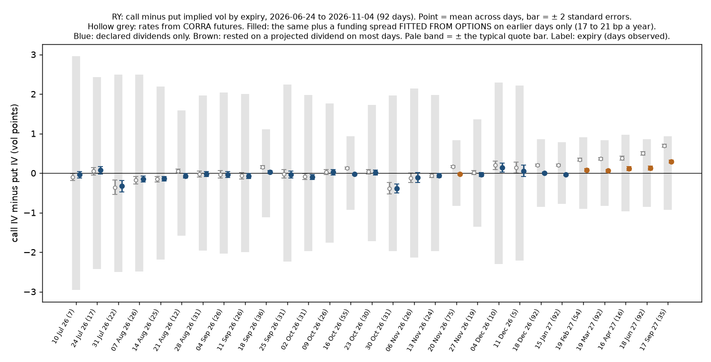

# Marked to the Tape

A risk system for a small book of Canadian listed options. It prices positions with its own engine for American options with discrete dividends. It compares the implied volatilities with Montreal Exchange settlements and with an independent source. Then it replays real historical days and shows what risk is left after hedging with SXF, ZEB and XIU.

**Status:** in progress. Done and tested: the pricing, inversion and Greeks core (`src/voleng.py`), the trading calendar (`src/tradingcal.py`), the Montreal Exchange loader (`src/loaders/mx.py`) and chain inversion (`src/surface.py`). The call-put check has run on all 124 RY days (`scripts/run_days.py`); it traces a small, persistent gap to funding cost and removes it out of sample, as described below.

## Data

This repository contains no exchange or vendor data. Montreal Exchange, Interactive Brokers and OptionMetrics data are licensed for personal use and can't be redistributed. Raw files stay on the author's machine under `data/`, which is excluded from version control. Everything published here is computed from them: errors in vol points, residuals and summary statistics.

### Montreal Exchange daily summary files (CAP)

Downloaded by hand from the exchange's website. Earliest date held: 8 May 2026 for RY
(124 trading days to 4 November 2026) and 10 September 2026 for XIU (41 trading days to
6 November 2026; four earlier months are still to download, in pieces of about two
months because the site limits the file size). The trading calendar accounts for every
date in both files, with none missing and none on a holiday.

Columns, identical in both files:

`Date, Symbol, Class Symbol, Root Symbol, Underlying Symbol, Strike Price, Expiry Date,
Call/Put, Ins. Type, Bid Price, Ask Price, Bid Size, Ask Size, Last Price, Volume,
Last Close Price, Net Change, Open Price, High Price, Low Price, Total Value,
Nb. Trades, Settlement Price, Open Interest, Implied Volatility,
Accrued Financing Value, Accrued Financing Date, CORRA Rate`

Notes from the header and counts only:

- `Call/Put` is 0 for a call and 1 for a put, confirmed two ways: the series symbol
  carries the letter, and call prices fall as the strike rises in every chain.
- `Ins. Type` is 0 for an option and 3 for the underlying, which has one row per day
  with a bid, an ask and a last trade.
- `Implied Volatility` is the exchange's own figure, in percent.
- `CORRA Rate` and `Accrued Financing Value` are zero on every row, so the interest
  rate has to come from another source.
- About 15% of RY option rows and 4% of XIU option rows have volume above zero. About
  93% carry a two-sided quote. The loader tags each row traded, quoted or
  settlement-only and inverts the quote midpoint where there is one.
- Near the money (within 10% of spot, 7 to 180 days), 99% of RY rows and 96% of XIU
  rows have a midpoint.
- The settlement falls outside the closing quote on about 6% of quoted RY rows and 1%
  of XIU rows, so the two are not taken at the same moment.
- The underlying's own quote in the file is about 20 basis points wide, so it does not
  pin the share price at the time the options were quoted.

## Run the tests

```
python -m venv .venv
.venv\Scripts\python -m pip install -r requirements.txt
.venv\Scripts\python -m pytest -v
```

On macOS or Linux, use `.venv/bin/python` instead.

## First result: calls against puts on RY



A call and a put at the same strike and expiry should imply the same volatility. If
they don't, a carry input (share price, rate or dividend) is wrong, because that kind
of error moves every strike of an expiry the same way.

The chart shows the mean gap for each expiry over 92 days (24 June to 4 November
2026). Three things are drawn for each expiry:

- **Pale band: the quote bar.** Half the bid-ask spread of the call plus that of the
  put, in vol points. A gap inside it cannot be traded on.
- **Hollow grey point: rates from CORRA futures alone.** Its bar is two standard
  errors of the mean, from the day-to-day scatter. A mean outside it is not noise.
- **Filled point: the same with a funding spread added.**

| Expiries | Futures only | Plus funding spread |
|---|---|---|
| Monthly, over 60 days, declared dividends | +0.15 | -0.02 |
| Monthly, over 60 days, projected dividends | +0.39 | +0.08 |
| Weekly, up to 30 days | -0.15 | -0.11 |

What it shows:

1. **Nothing here is a trade.** Every gap is inside the quote bar.
2. **The overnight rate is too low a funding rate.** The base curve is built from
   three-month CORRA futures, the market's forecast of the overnight rate. With it
   alone, long monthly expiries show calls 0.15 vol points above puts, the same at
   every strike. As a forward price the error grows with maturity at about 17 basis
   points a year. Treasury bills give the same picture (20 basis points).
3. **A spread fitted from earlier days removes it.** Each day uses the mean spread
   implied by the options on previous days only, never its own. On expiries that
   rest on declared dividends the gap falls to -0.02, which is zero within error.
4. **Dividend projections are tested, not fitted.** 2027 dividends are projected by
   a rule from RBC's own history (a raise twice a year, the size of last year's).
   With no raise the gap was -0.19; with the rule it is +0.08. The rule overshoots
   a little at the longest expiry.
5. **The time of day a dividend comes off matters.** Weekly expiries just after an
   ex-dividend date showed puts about 0.6 vol points above calls. The model was
   dropping the share price at the close of the ex-date; it really opens lower that
   morning. Moving the drop to the open cut that gap to about 0.36. What remains
   suggests time should be counted in trading sessions, which is not done yet.

Limits. The spread is fitted from the same option market the check then tests, so
on rates this check is not independent; it is labelled "fitted from options"
wherever it is used. The futures curve is independent, and it shows a spread is
needed but cannot say what it should be. Standard errors treat days as independent,
and neighbouring days are not. The share price is implied from the nearest monthly
expiry, so that expiry is left out on the days it is used. This is one name over
six months.
